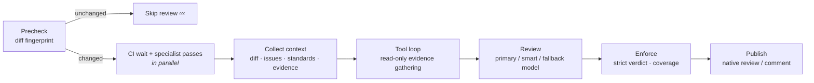

<div align="center">

# 🤖 pr-reviewer-action

**AI pull request reviews with any OpenAI- or Anthropic-compatible model — cloud or self-hosted.**

*Point it at your llama.cpp box or your Anthropic key. Either way, every PR gets a real review.*

[](https://github.com/misospace/pr-reviewer-action/actions/workflows/ci.yaml)
[](https://github.com/misospace/pr-reviewer-action/releases)
[](LICENSE)

**[Quick start](#-quick-start)** · **[Documentation](docs/README.md)** · **[Inputs](docs/inputs.md)** · **[Troubleshooting](docs/troubleshooting.md)** · **[Migrating from v2](docs/v3-migration.md)**

</div>

---

The action reviews each pull request with the model you point it at. It collects the diff, linked issues, CI results, repository standards and evidence; lets the model read the checkout through a bounded, read-only tool loop; and publishes structured findings with a verdict derived from them, as a native review or a sticky comment.

## ✨ Highlights

- 🏠 **Local-model-first**: ollama, llama.cpp, vLLM, LiteLLM, or any OpenAI/Anthropic-compatible endpoint, with an optional fallback model.
- 🔎 **Gathers its own evidence**: a native tool loop reads files, greps, follows git history and calls GitHub APIs or MCP servers before the verdict, with a budget that scales with the PR.
- 🧭 **Deterministic classification**: rule-based risk flags and required checks keep smaller models focused; specialist passes run only when the change warrants them.
- ⚖️ **Verdicts you can audit**: request changes only for open blocker/major findings, and a review that couldn't read everything says so and never approves.
- 💸 **Token-saving**: an unchanged diff skips the model entirely and carries the prior verdict forward.
- 🛡️ **Safe by default**: standards and prompts read from the base branch, read-only tools, secret redaction, approvals off unless you select `publish-mode: review_verdict`, cross-repository approvals off unless `approve-forks: true`, fork PRs isolated.

## 🚀 Quick start

```yaml
name: AI PR Review

on:
  pull_request:
    types: [opened, reopened, synchronize, ready_for_review]

permissions:
  contents: read
  pull-requests: write
  checks: read

jobs:
  review:
    if: ${{ !github.event.pull_request.draft }}
    runs-on: ubuntu-latest
    steps:
      - uses: actions/checkout@v5
        with:
          fetch-depth: 0
          ref: ${{ github.event.pull_request.head.sha }}

      - uses: misospace/pr-reviewer-action@v3
        with:
          ai-base-url: ${{ vars.AI_BASE_URL }}
          ai-api-key: ${{ secrets.AI_API_KEY }}
          ai-model: ${{ vars.AI_MODEL }}
```

That is the whole setup: an OpenAI-compatible endpoint (set `ai-api-format: anthropic` for an Anthropic-compatible one), its key, and a model. The defaults are the recommended configuration: the native tool loop gathers evidence from the checkout, specialist leads run when the change warrants them, CI results are folded in as evidence, and findings post as a non-blocking review anchored to the diff. `github-token` defaults to the job token. The `if:` guard on the job is a cheap early exit, not the authority — the action's precheck skips draft PRs deterministically, so a workflow that forgot it still never reviews a draft.

### Specialist model overrides

Deep-review specialists inherit the primary model by default. These workflow inputs opt into a shared specialist profile and optional model-only role overrides; the profile's endpoint and credentials are shared by all three roles.

| Input | Purpose |
|---|---|
| `ai-specialist-model` | Enable a specialist model profile; blank keeps the current primary-profile behavior. |
| `ai-specialist-base-url` | Optional profile endpoint; blank inherits the primary endpoint. Requires `ai-specialist-model`. |
| `ai-specialist-api-format` | Optional profile format (`openai` or `anthropic`); blank inherits the primary format. Requires `ai-specialist-model`. |
| `ai-specialist-api-key` | Optional profile key; blank inherits the primary key. Requires `ai-specialist-model`. |
| `ai-specialist-correctness-model` | Model-only override for the correctness role. |
| `ai-specialist-security-model` | Model-only override for the security role. |
| `ai-specialist-tests-model` | Model-only override for the tests role. |

Role overrides share the profile transport and are ignored with a warning for `DEEP_REVIEW_EXECUTION=combined_scout`, which makes a single shared model call. See [Models and routing](docs/models-and-routing.md#specialist-profile-overrides) for precedence and examples.

**Requirements:** it is a JavaScript action (`runs.using: node24`), so GitHub-hosted runners need nothing installed; the runner provides Node. The repository under review must be checked out (`fetch-depth: 0` gives the history context). `checks: read` lets the review wait for CI; without it the CI evidence is skipped. On Forgejo, use runner 9 or newer with a job image that has Node 22+ and `git`.

### Independent confidence scorer (opt-in)

Set `ai-confidence-model` and the review runs one extra, bounded model call that grades the finished review 0–5 with a risk band. Default off: without the model the scorer costs nothing and nothing confidence-related appears anywhere.

| Input | Purpose |
|---|---|
| `ai-confidence-model` | Enable the scorer; blank (default) keeps every confidence surface off. |
| `ai-confidence-base-url` | Optional scorer endpoint; blank inherits the primary endpoint. |
| `ai-confidence-api-format` | `openai` (default) or `anthropic`; blank inherits the primary format. |
| `ai-confidence-api-key` | Scorer endpoint key. A distinct endpoint never inherits the primary key. |
| `ai-confidence-timeout-sec` | Wall-clock budget for the scorer call, default 120. |
| `ai-confidence-reasoning-effort` | Optional effort token; blank omits the field entirely. |
| `ai-confidence-enable-for-forks` | Operator-only; default `false` keeps the scorer off cross-repository (fork) PRs, because the prompt carries the review's own privileged output to a separate endpoint under a privileged credential. |

**Local models:** point `ai-confidence-base-url` at your server's OpenAI-compatible URL (e.g. `http://localhost:11434/v1` for ollama) with `ai-confidence-api-format: openai`; Anthropic-compatible local proxies take `ai-confidence-api-format: anthropic`. A keyless scorer endpoint may only be loopback (`localhost`, `127.0.0.1`, `::1`) — any other distinct endpoint must set `ai-confidence-api-key`, because the primary lane's key never rides a different URL.

**Cost ceilings:** exactly one extra model call per published review — bounded (1,024 completion tokens, no tools, no corpus), one wire attempt, no retries. The call is capped by `ai-confidence-timeout-sec` (default 120s). Any failure — timeout, HTTP 429/5xx, malformed answer — degrades to `confidence-status: unscored`. The review itself is unchanged — same verdict, findings, required checks, and approval — but the published body gains the additive advisory `Independent confidence` section and the review marker gains the confidence keys.

**What a score means:** advisory confidence in *this review* (how well it covered and supported its own conclusions) — not a probability the code is correct, and no verdict or approval authority. The score never changes the verdict, findings, or required checks. Deterministic caps outrank the model: a blocker finding caps the score at 2, a major finding or partial review coverage at 3.

**Independence:** the scorer resolving to the same endpoint and model that wrote the review is correlated self-grading, not independent evidence — the action warns about it. Point `ai-confidence-base-url` at a different backend for a genuine second opinion.

**Where results appear:** the five `confidence-*` step outputs, an `Independent confidence` row in the step summary, an advisory section in the published review, the additive confidence keys in the review marker, and the `confidence-score.json` / `confidence-request.json` / `confidence-response.json` run artifacts. Disabled runs keep all of it absent.

## ⚙️ How it works



## 🖥️ Platform support

The action works on **GitHub** and **Forgejo** (1.4.x), with **Tangled** resolvable as a platform. Set `platform: auto` (default) to detect automatically from `TANGLED_REPO_DID` (the Tangled repository owner DID, checked first), `GITHUB_SERVER_URL`, and `FORGEJO_API_URL`, or set explicitly to `forgejo` / `github` / `tangled` (explicit `tangled` requires `TANGLED_REPO_DID`). Tangled is resolution-only for now: its backend operations are not implemented yet and fail loudly until follow-up work lands.

| Feature | GitHub | Forgejo |
|---|---|---|
| PR diff, files, metadata | ✅ Full | ✅ Full (REST backend) |
| Managed sticky comment | ✅ Full | ✅ Full |
| Native review comments (`review_comment`) | ✅ Full | ⚠️ Degraded — REST-based; no inline line anchors |
| Native review verdicts (`review_verdict`) | ✅ Full | ⚠️ Degraded — approve/request_changes via REST |
| Native blocking reviews (`review_blockers`) | ✅ Full | ⚠️ Degraded — request_changes/comment via REST |
| Cleanup: dismiss stale reviews | ✅ Full | ✅ Full (REST) |
| Cleanup: minimizeComment (hide outdated) | ✅ Full | ⚠️ Incomplete-replacement path: author-side deletion of superseded non-verdict (COMMENTED/DISMISSED) non-official reviews that carry no inline findings (REST); verdict reviews degrade to dismissal and are never deleted (verdict deletion could reactivate a stale verdict upstream); findings-bearing reviews stay visible (no GraphQL) |
| CI status check polling | ✅ Full | ✅ Commit-status polling (Forgejo REST; own single-job status auto-discovered by run-jobs API) |
| Evidence providers | ✅ Full | ✅ Full |
| Tool harness | ✅ Full | ✅ Full |
| Reviewer-requested smart escalation | ✅ Full | ✅ Full |

Forgejo Authorized Integrations can reuse managed sticky comments with repository and issue permissions; `read:user` is not required. The action matches the integration owner's ID from its Forgejo-generated audience against comment author IDs. If a prior managed comment has no usable author ID and ownership cannot be established, publication fails closed.

**PR reviewability metadata is capability-checked, not version-guessed.** A successfully read PR must explicitly report a boolean `draft` value to be reviewable: `draft: true` skips as `pr-draft`, while a readable payload with a missing or malformed draft bit fails closed as `pr-draft-unknown`. A failed PR metadata lookup on the ordinary shared-admission path is an operational failure and fails the run rather than producing a green skip; the human-triggered re-review command keeps its retriable `comment-pr-lookup-failed` behavior. We intentionally do not claim a Forgejo version floor for the `draft` field: deployments and API compatibility layers vary, and the runtime checks the capability directly. If an instance repeatedly reports `pr-draft-unknown`, its pull-request endpoint must be upgraded or configured to return an explicit boolean `draft`.

> **Note:** On Forgejo, features requiring GitHub's GraphQL API (review minimization) are skipped with a clear log line. CI auto-discovery requires Forgejo v16.0+ (the first release with the run-jobs API) and excludes a pending status only when that API proves this is a single-job run. If the job has an `html_url`, its path must exactly match the status `target_url` path on the runner's origin. Forgejo v16 jobs omit `html_url`; in that case the job's `run_id` must match the queried run, and the status must target a job page for the runner's repository and run number. `FORGEJO_RUN_NUMBER`/`GITHUB_RUN_NUMBER` identify candidate status URLs; `FORGEJO_RUN_ID` (or `GITHUB_RUN_ID` fallback) is used only to query the jobs API. Multi-job, mismatched, and unavailable cases leave statuses visible; older Forgejo instances warn immediately and fall back to bounded waiting, so set `CI_STATUS_CONTEXT` to avoid self-deadlock; a whitespace-only value is treated as unset and enables auto-discovery. Multi-job reviewer workflows also need `CI_STATUS_CONTEXT`. The core review pipeline and all REST-based features work fully.

### 🛑 Terminal provider failures (quota exhausted, retired model)

A provider error body can state a **permanent** condition: the account's quota is spent, billing is hard-limited, or the model is retired/deprecated/removed. No later attempt fixes any of them, so both retry layers consult one shared classifier and stop immediately, letting the run reach the configured fallback (`ai-fallback-model`) in seconds instead of after minutes of silent retries.

Allowlisted as terminal — nothing else is:

| Reason | Recognized evidence |
|---|---|
| `quota_exhausted` | Structured codes `insufficient_quota`, `quota_exceeded`, `usage_limit_reached`, `billing_hard_limit_reached`, `billing_not_active`, `credit_exhausted`, `plan_exhausted`, `token_plan_usage_limit_reached`; prose such as `insufficient quota`, `insufficient balance`, `insufficient credit`, `you exceeded your current quota`, `billing hard limit has been reached`, `token plan usage limit reached`, `upgrade your token plan or purchase credits`. LiteLLM/MiniMax code `2056` is never decisive on its own — a bare `2056` in any body is just an unrelated number — so the token-plan sentences beside it are what count. |
| `model_unavailable` | Structured codes `model_not_found`, `model_deprecated`, `model_retired`, `model_unavailable`, `model_removed`, `deprecated_model`, `unknown_model`, `DeploymentNotFound`; prose such as `has been retired`, `has been deprecated`, `is deprecated and will be removed`, `model not found`, `does not exist or you do not have access`, `no access to this model`, `unknown model`. |

Deliberately **not** terminal (these stay retryable): `rate limit`, `too many requests`, `resource_exhausted`, RPM/TPM phrasing, `try again later`, `retry after/later/in`, `model is loading`, `model is busy`, `model is temporarily unavailable`, `server overloaded`, unknown provider bodies, and any phrase whose own text says the condition is temporary.

Two deliberate boundaries worth knowing:

- **Prose evidence is 4xx-only.** A 5xx body is server-composed text that routinely echoes request content back, so allowing prose to end a 5xx retry budget would let request content decide it. Structured codes still count at any status — a provider has to *construct* `insufficient_quota` to send it.
- **A 4xx body that quotes the review corpus and happens to contain an allowlisted phrase is accepted** as the provider's own claim. Rejecting an echo structurally would mean a leading-sentence or delimiter heuristic, which cannot be told apart from a real provider message without risking the false negative this feature exists to prevent. The consequence is bounded: an immediate, truthfully-logged fallback (availability recovery) — never a verdict change, a gate bypass, or a fabricated outcome.

Telling the two apart in the log — a terminal stop is named; a transient retry is just slow:

```text
terminal provider failure: quota_exhausted (litellm_minimax_token_plan) HTTP 429; bypassing same-request retries
Primary: transport failures exhausted (HTTP 429: …) [terminal quota_exhausted (litellm_minimax_token_plan) HTTP 429; bypassing retries]
::error::Primary: model endpoint returned a non-retryable HTTP status [terminal=quota_exhausted]; failing over without retrying (…)
Primary: terminal=quota_exhausted; bypassing retries; trying fallback: <model> @ <base-url> (openai)
```

No Action input controls this: the signatures are a fixed allowlist. Every failure the classifier leaves alone (an unrecognized 429, a 5xx, a network/timeout failure) is **ambiguous**, and ambiguous primary failures are hard-bounded (#1305): at most **one short retry** (tier sleeps capped at 5 s), then the run hands off promptly to the configured fallback (`ai-fallback-model`). `ai-primary-retries` remains a total-attempt cap but can no longer buy more than that allowance, and `ai-primary-retry-delay-sec` is honoured only when smaller than the 5 s cap — primary-to-fallback latency never depends on classifying provider prose correctly. Residual per-attempt latency is the transport's own same-request retry tree (3 attempts, 1 s/2 s, a provider `Retry-After` honoured up to 30 s) and each attempt's configured `ai-request-timeout-sec`. Specialist lanes latch too — once an endpoint/model/format/credential lane answers terminally, later calls on that same lane short-circuit without a wire request (`lane terminally unavailable (<reason>)`). The credential is part of the lane key (as a truncated digest, never the key), because quota exhaustion is an account condition: a differently keyed lane against the same endpoint has its own budget and is not latched.

## 📚 Documentation

| Topic | Page |
|---|---|
| Every input and output, with defaults | [Inputs and outputs](docs/inputs.md) |
| What the reviewer sees and how to steer it (standards, prompts, evidence, CI) | [Context and evidence](docs/context-and-evidence.md) |
| The native tool loop, budgets and partial coverage | [Tool loop](docs/tool-loop.md) |
| Specialist passes and `deep-review: auto` | [Deep review](docs/deep-review.md) |
| Verdict policies, publish modes, re-reviews | [Verdicts and publishing](docs/verdicts-and-publishing.md) |
| Endpoints, fallback and fast/smart routing | [Models and routing](docs/models-and-routing.md) |
| Review marker fields and the step summary | [Telemetry](docs/telemetry.md) |
| Default-off experimental features | [Opt-in features](docs/opt-in-features.md) |
| Local model issues and common misconfigurations | [Troubleshooting](docs/troubleshooting.md) |
| Repository-owned config file | [Repository config](docs/repository-config.md) |
| Reviewing pull requests from forks | [Fork reviews](docs/fork-review.md) |
| Upgrading from v2 | [v2 → v3 migration](docs/v3-migration.md) |

Copyable workflows: [`examples/workflow-self-hosted.yml`](examples/workflow-self-hosted.yml) and [`examples/workflow-cloud.yml`](examples/workflow-cloud.yml).

## 📌 Version pinning and releases

The action is versioned with Git tags. `@v3` is a floating major tag; for reproducible runs, pin a release tag or its commit SHA (Renovate keeps either current):

```yaml
- uses: misospace/pr-reviewer-action@v3.1.0
# or
- uses: misospace/pr-reviewer-action@aa12ad9909b1ee8a5a7fe00dceeb1a8c97ab27dd # v3.1.0
```

Release tags point at a build commit that contains `dist/`; `main` does not carry the bundle. Releases are cut by merging the standing `release: X.Y.Z` pull request that release-please maintains.

### 🗓️ Versioning policy

- **Patch** (`Z`): bug fixes, docs, performance work and internal refactors.
- **Minor** (`Y`): new inputs, outputs, tools or modes, and deliberate changes to the reviewer's operating point (such as the v3.1.0 tool budget). Release notes call out anything that changes review behavior.
- **Major** (`X`): anything that can require editing your workflow, such as removing or renaming inputs/outputs or dropping platform support.
- **Deprecations** keep working, with a log warning, for the rest of the current major.
- **`source-vX.Y.Z` tags** mark each release's source commit on `main` for release tooling. They have no `dist/`, so never pin to them.
- **Pre-releases** (`vX.Y.Z-rc.N`) never move the floating major tag.

Published release notes get rewritten from the raw changelog — see [`docs/release-notes.md`](docs/release-notes.md) for the house style and the procedure.

Subscribe to [GitHub Releases](https://github.com/misospace/pr-reviewer-action/releases) to follow changes.

### 🚚 v3 breaking changes

If you used `review_scope: auto|incremental|full` in v2, remove the input in v3. There is no replacement: every changed review uses the full current PR. Keep `skip-if-diff-unchanged` for the zero-token unchanged-review skip; it retains the prior overall verdict. The `ai-review` label, a `/ai-review` PR comment, or `force-review: "true"` still forces a fresh full review. Comment re-review is for triage-or-higher commenters only (fork PRs get a reply pointing at the fork review workflow) and an empty `rereview-command` disables it — see [Verdicts and publishing](docs/verdicts-and-publishing.md#comment-command).

Stop reading the removed incremental outputs (`effective_review_scope`, `previous_head_sha`, `previous_base_sha`, `baseline_clean`) and remove `escalate_on_dirty_baseline` if configured. Previous findings and evidence are not carried into a new review. No replacement scope or dirty-baseline setting is needed.

## 🧪 Development

A clean checkout is one noninteractive command:

```bash
scripts/bootstrap.sh
```

It verifies (and if needed installs) the pinned [mise](https://mise.jdx.dev) launcher, installs the locked toolchain, and runs `npm ci`. Everything is user-scoped and digest-verified — no privileged installs, no global config or git-hook changes. It runs no tests, formatters or generators, and it is idempotent and convergent: a re-run re-checks the prerequisites and re-runs `npm ci`, so it is safe to repeat. It fails with a clear message if `pgrep`/`pkill` (procps) are missing, because process-tree cleanup and gate preflight refuse to run without them.

The Node version pin lives in [`.mise/config.toml`](.mise/config.toml), where it tracks CI's `node-version: '26'` and the `@types/node` major in `package.json`; [`.mise/mise.lock`](.mise/mise.lock) pins its download checksums. The shipped action still declares the `node24` runtime (`runs.using`), because the Actions runner has no `node26` selector yet; CI re-runs the full suite on Node 24 (`validate-runtime-floor`) so the Node-26 typings can never green-light an API the shipped runtime lacks. The launcher is installed into a user-scoped directory that is often not on `PATH`, so bootstrap prints the exact `export PATH=…` line to run (and to add to your shell rc). Reuse that environment with `mise exec -- <command>`, or run:

```bash
mise run check   # fast static validation (typecheck)
mise run test    # the shipped v3 runtime, end-to-end against mock platform and model servers
```

`npm ci && npm run typecheck && npm test` stays authoritative for CI and for anyone without mise (as does `npm run build` for the release bundle — `dist/` is not committed).

The Python suites are auxiliary tooling, not the shipped action, and their interpreter is not part of the bootstrap contract. Run them on the same 3.14 interpreter CI pins — `setup-python` installs `requirements.txt` into the user-scoped mise directory on demand, and `test-python` runs the suites:

```bash
mise run setup-python && mise run test-python
```

Contributor and agent docs (code map, architecture, eval runbooks) start at [`AGENTS.md`](AGENTS.md); evaluation is in [`docs/evals.md`](docs/evals.md).

## 🔐 Security

See [SECURITY.md](SECURITY.md) for the threat model, controls, and operational guidance.

### Fork PR reviews

Pull requests from forks are reviewed by a separate, privilege-separated
workflow (`ai-pr-review-fork.yaml`): default-deny behind the maintainer-only
`ai-review-fork` label, local models only, no fork code ever checked out or
executed in the privileged run, and bounded compute. The same-repository
dogfood reviewer skips fork PRs cleanly. See
[docs/fork-review.md](docs/fork-review.md) for the threat model, the
authorization flow, and the required `FORK_*` configuration.

## 📄 License

[MIT](LICENSE)

---

<div align="center">

Built for homelabs and production alike — if this action reviews your PRs well, consider **[starring the repo ⭐](https://github.com/misospace/pr-reviewer-action)**

<sub>[⬆ Back to top](#-pr-reviewer-action)</sub>

</div>
